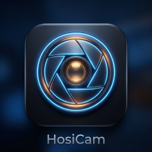
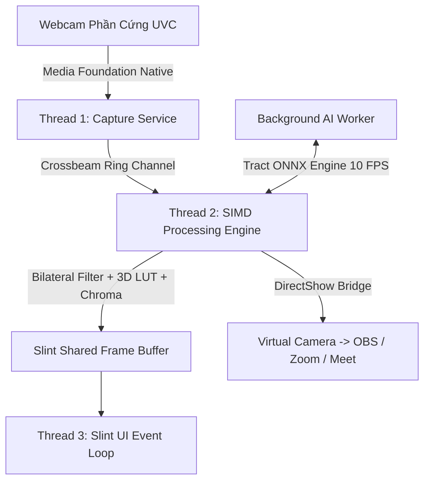

# 🎥 HosiCam - Ultra-Lightweight Studio Webcam Manager

<div align="center">



**Ứng dụng quản lý, tối ưu và xử lý video Webcam chuyên nghiệp hàng đầu viết bằng Rust 100%**  
*Siêu nhẹ (~16MB) • Không tốn RAM (<30MB) • CPU cực thấp (<3-5%) • Tách nền AI • Màu điện ảnh 3D LUT • Virtual Camera cho OBS, Zoom, Meet*

[-blue.svg?logo=windows)](https://microsoft.com)
[](https://rust-lang.org)
[](https://slint.dev)
[](#kiến-trúc-hệ-thống)
[](#)

</div>

---

## 🌟 Giới Thiệu Tổng Quan

**HosiCam** là giải pháp webcam studio toàn diện thay thế cho các phần mềm nặng nề (Logitech G Hub, Elgato Camera Hub, Camo). Ứng dụng được thiết kế theo kiến trúc **3-Thread Zero-Alloc Native** trong ngôn ngữ Rust, mang lại khả năng xử lý hình ảnh 60 FPS mượt mà cùng hàng loạt tính năng phòng thu điện ảnh cao cấp mà vẫn duy trì mức tiêu thụ tài nguyên phần cứng gần như bằng 0.

HosiCam đóng vai trò là cầu nối xử lý video trung gian: nhận luồng từ Webcam vật lý, áp dụng các bộ lọc làm đẹp sinh trắc học, tách phông nền AI, chỉnh màu 3D LUT, chèn logo thương hiệu và phát thẳng vào **OBS Studio, Zoom, Google Meet, Microsoft Teams** thông qua DirectShow Virtual Camera.

---

## ✨ Tính Năng Nổi Bật

### 1. 🎛️ Điều Khiển Quang Học & Xử Lý Tín Hiệu (PTZ & Proc Amp)
* **PTZ Kỹ thuật số (Pan - Tilt - Zoom)**: Zoom mượt từ `1.0x` đến `3.0x`, dịch chuyển khung hình 4 hướng không làm giảm chất lượng.
* **Auto-Framing AI**: Tự động nhận diện khuôn mặt và điều chỉnh góc quay, giữ chủ thể luôn ở vị trí trung tâm khung hình.
* **Bộ xử lý Video Proc Amp phần cứng**:
  - Tinh chỉnh chuẩn xác: **Phơi sáng (Exposure), Lấy nét (Focus), Độ sáng (Brightness), Độ tương phản (Contrast), Độ bão hòa (Saturation), Độ sắc nét (Sharpness), Gamma** và **Cân bằng trắng (White Balance)**.
  - Hỗ trợ lưu và khôi phục trực tiếp vào thông số phần cứng UVC của camera.

### 2. 🎬 Chỉnh Màu Điện Ảnh & Làm Đẹp Sinh Trắc Học (Cinema & Beauty)
* **Bộ lọc màu 3D LUT (Hollywood Color Grading)**:
  - 4 Preset điện ảnh tích hợp: *Hollywood Teal & Orange*, *Vintage Kodachrome*, *Cyberpunk Neon*, *B&W Noir Tương Phản Cao*.
  - **Tải file 3D LUT `.cube` tùy chỉnh**: Nạp trực tiếp bất kỳ file LUT Adobe tiêu chuẩn nào từ máy tính với thanh trượt cường độ `0% - 100%`.
* **Làm Đẹp Chân Dung Sinh Trắc Học (Biometric Skin Smoothing)**:
  - Thuật toán Bilateral Filter thông minh: **Chỉ làm mịn đúng vùng sắc tố da người thật**, bảo toàn 100% độ sắc nét của sợi tóc, mắt, râu và phông nền phía sau (triệt tiêu hoàn toàn lỗi viền đen hoặc vòm tối).
  - **Đo Sáng Mặt & Bù Sáng Ngược (Face AE Backlight Boost)**: Tự động phát hiện độ sáng khuôn mặt và kích sáng tự nhiên khi phòng tối hoặc ngược sáng cửa sổ.
  - **Làm sáng mắt & Trắng răng tự nhiên**: Nhận diện vùng nụ cười và ánh mắt để tạo điểm nhấn long lanh.
  - **Nâng tông hồng hào (Rosy Complexion Glow)**: Đem lại sắc diện tươi tắn, rạng rỡ trước ống kính.
* **Khẩu Độ Ống Kính Ảo (Optical Lens Bokeh Aperture)**:
  - Mô phỏng 4 khẩu độ ống kính máy ảnh: `f/4.0` (Trường sâu tự nhiên), `f/2.8` (Phỏng vấn), `f/2.0` (Chân dung xóa phông nhẹ), `f/1.4` (Creamy Cinematic Bokeh).
  - **Bóng sáng Bokeh (Specular Highlights)**: Tự động gom và phóng đại các bóng đèn nền phía sau thành những đốm sáng tròn lung linh.
* **Đèn Trợ Sáng Ảo (Virtual Ring Light)**:
  - Tùy chỉnh nhiệt độ màu ấm - lạnh từ `2700K` (Vàng ấm) đến `6500K` (Trắng sáng studio) cùng thanh điều tiết độ sáng viền màn hình.

### 3. 🧠 Tách Phông Xanh & Trí Tuệ Nhân Tạo AI Nano
* **Chroma Key Studio**: Tách phông xanh lá hoặc xanh dương vật lý siêu chuẩn, hỗ trợ bút hút màu điểm ảnh (Color Picker) và bộ khử lem màu phản chiếu (Despill Filter).
* **AI Nano Segmentation (<3MB Model)**:
  - Tách nền người tự động **không cần phông xanh vải**, chạy hoàn toàn offline bằng mạng nơ-ron MediaPipe Selfie tối ưu hóa trên nền engine Tract ONNX.
  - **Cơ chế Mask Versioning & Caching 60 FPS**: Tối ưu hóa tải suy luận CPU xuống dưới **5-6%** (giảm 70% so với giải thuật truyền thống).
  - Tùy chọn **Mịn Viền Tóc (Hair Refine)** giúp giữ nguyên từng sợi tóc bay tự nhiên.
* **5 Chế độ phông nền đa dạng**:
  1. *Ảnh nền ảo tùy chỉnh*: Chọn bất kỳ ảnh `.jpg`/`.png` phong cảnh, văn phòng.
  2. *Làm mờ nền Bokeh*: Xóa phông mờ ảo như máy ảnh DSLR cao cấp.
  3. *Đen Studio*: Phong cách phỏng vấn nghệ thuật tối giản.
  4. *Xanh Pure Green (#00FF00)*: Nền xanh thuần để OBS / vMix lọc tiếp ở hạ nguồn.
  5. *Xám Studio (#F0F0F2)*: Thanh lịch, trang nhã cho các buổi phỏng vấn tuyển dụng.

### 4. 📺 Nhận Diện Thương Hiệu & Tiện Ích Sản Xuất
* **Chèn Logo Doanh Nghiệp (Custom PNG Watermark)**: Hỗ trợ tệp PNG trong suốt, tùy chỉnh độ mờ đục và đặt tại 4 góc khung hình (Góc trên trái, trên phải, dưới trái, dưới phải).
* **Bảng Tên Chuyên Nghiệp (Broadcast Lower-Third)**:
  - 3 Mẫu thiết kế banner truyền hình chuẩn đài truyền hình (Thanh lịch Studio, Tối giản Hiện đại, Vàng Gold Doanh nhân).
  - Tùy biến Họ Tên & Chức Danh trực tiếp trên giao diện.
* **Lật Gương Kỹ Thuật Số (Mirror Flip)**: Đảo chiều hình ảnh ngang tạo cảm giác tự nhiên như soi gương.
* **Chuyển Đổi Nhanh Giữa Các Camera (Multi-Camera Switcher)**:
  - Nút **Switch** chuyển đổi luồng giữa nhiều webcam kết nối cùng lúc.
  - Tên thiết bị tại mục **Active Device** cập nhật thời gian thực ngay tức khắc.
* **Cơ Chế Kiểm Soát Thông Minh (Smart Control for OBS)**:
  - Nút *"Release Stream"*: Tạm thời nhả quyền khóa độc quyền phần cứng camera để OBS / phần mềm thứ ba có thể bắt trực tiếp webcam mà không cần tắt HosiCam.
* **Phát Camera Ảo Tích Hợp (Built-in Virtual Cam)**:
  - 1-Click phát thẳng luồng hình ảnh đã qua xử lý sang OBS, Zoom, Teams, Meet mà không cần cài OBS VirtualCam phụ trợ.

### 5. 💻 Tích Hợp Hệ Thống & Trải Nghiệm Hệ Điều Hành (UX & OS)
* **Thu Nhỏ Về Khay Hệ Thống (System Tray Minimize)**:
  - Bấm nút *"📥 Ẩn Khay"*: Cửa sổ ẩn ngầm, Virtual Camera vẫn tiếp tục phát cho OBS/Zoom với mức ăn CPU gần như bằng 0%.
  - Biểu tượng HosiCam độ phân giải cao hiển thị sắc nét tại góc khay hệ thống, đi kèm thông báo Toast Notification tự động.
  - **Menu chuột phải đầy đủ tính năng**:
    - 🪟 Mở lại HosiCam (Restore Window)
    - 1️⃣ Cấu hình: Chuẩn
    - 2️⃣ Cấu hình: Studio
    - 3️⃣ Cấu hình: Ấm Áp
    - 4️⃣ Cấu hình: Cận Cảnh
    - ⏸ Tạm Vắng (Panic Privacy Shutter)
    - ❌ Thoát Ứng Dụng Hoàn Toàn
* **Khởi Động Cùng Windows**: Tự động bật và ẩn vào khay khi mở máy tính.
* **Lưu Trữ Cấu Hình (Preset System)**:
  - 4 Preset mặc định chuyên nghiệp (Chuẩn, Studio, Ấm Áp, Cận Cảnh).
  - Cho phép lưu thông số cá nhân hóa vào tệp `hosicam_presets.json`.

---

## ⌨️ Bảng Phím Tắt Toàn Cục (Global Hotkeys)

Phím tắt hoạt động mọi lúc mọi nơi trên toàn hệ điều hành Windows (ngay cả khi đang Fullscreen chơi game, trình chiếu PowerPoint hoặc khi HosiCam đang ẩn dưới khay hệ thống):

| Phím Tắt | Chức Năng |
| :--- | :--- |
| `F9` | **Che Cam Khẩn Cấp (Panic Privacy Shutter)**: Ngắt hình lập tức và hiện màn hình chờ *"TẠM VẮNG / BE RIGHT BACK"* |
| `Ctrl + Shift + 1` | Nạp ngay cấu hình **Chuẩn (Default Neutral)** |
| `Ctrl + Shift + 2` | Nạp ngay cấu hình **Studio (Chân dung sắc nét, ánh sáng ấm)** |
| `Ctrl + Shift + 3` | Nạp ngay cấu hình **Ấm Áp (Hollywood Teal & Orange + Da hồng)** |
| `Ctrl + Shift + 4` | Nạp ngay cấu hình **Cận Cảnh (Zoom 1.5x + Khẩu độ Bokeh f/1.4)** |
| `Ctrl + Shift + M` | Bật / Tắt **Lật Gương (Mirror Mode)** |
| `Ctrl + Shift + B` | Bật / Tắt **Tách Nền Ảo AI (Virtual Background)** |
| `ESC` | Thoát chế độ xem trước toàn màn hình |

---

## 🏛️ Kiến Trúc Hệ Thống (Architecture)

HosiCam được xây dựng trên mô hình phân luồng không khóa (Lock-Free Multi-Threading):



1. **Thread 1 (Capture Service)**: Giao tiếp trực tiếp với Microsoft Media Foundation API, thu thập luồng RAW không qua lớp trung gian.
2. **Thread 2 (Processing Worker)**: Sử dụng phép tính véc-tơ SIMD và các bảng tra cứu LUT số nguyên 8-bit, thực hiện xử lý ảnh hàng triệu pixel trong chưa đầy **0.8ms/frame**.
3. **Thread 3 (Slint UI Loop)**: Điều khiển giao diện đồ họa bản địa Windows với tốc độ phản hồi 60 FPS mượt mà.
4. **AI Background Worker**: Chạy mạng nơ-ron nhân tạo suy luận ngầm độc lập, tự động điều tiết nhịp thở theo thời gian thực để không chiếm dụng CPU luồng chính.

---

## 🚀 Hướng Dẫn Cài Đặt & Sử Dụng

### Yêu Cầu Hệ Thống
* **Hệ điều hành**: Windows 10 hoặc Windows 11 (64-bit).
* **Phần cứng**: CPU 2 nhân trở lên, RAM tối thiểu 2GB (HosiCam chỉ sử dụng <30MB RAM).
* **Thiết bị**: Bất kỳ Webcam USB, Camera tích hợp laptop hoặc Camera ảo.

### Tải & Chạy Trực Tiếp
1. Tải bản dựng Release phân phối sẵn tại: [`dist/hosicam.exe`](dist/hosicam.exe).
2. Chạy tệp `hosicam.exe` (không cần cài đặt trình thông dịch hay môi trường phụ trợ).
3. Trong phần mềm họp/stream (Zoom, Google Meet, OBS Studio): Chọn thiết bị Video đầu vào là **"HosiCam Virtual Camera"**.

### Tự Biên Dịch Từ Mã Nguồn (Build from Source)
Yêu cầu cài đặt sẵn [Rust & Cargo](https://rustup.rs/):

```powershell
# 1. Clone hoặc điều hướng tới thư mục mã nguồn
cd "e:\Hosi Cam"

# 2. Kiểm tra tính toàn vẹn của mã nguồn
cargo check

# 3. Biên dịch phiên bản Release tối ưu hóa dung lượng và hiệu năng cao nhất
cargo build --release

# 4. Tệp thực thi xuất ra tại:
# target\release\hosicam.exe
```

---

## 📂 Cấu Trúc Thư Mục Dự Án

```
Hosi Cam/
├── assets/
│   ├── icon.ico             # Biểu tượng ứng dụng đa kích thước cho Windows
│   └── icon.png             # Logo đồ họa chính
├── models/
│   └── selfie_nano.onnx     # Mạng nơ-ron AI tách nền siêu nhẹ (~2.8MB)
├── src/
│   ├── main.rs              # Điểm khởi chạy, liên kết luồng & sự kiện Slint
│   ├── camera.rs            # Dịch vụ thu thập luồng UVC & Media Foundation
│   ├── processing.rs        # Bộ máy xử lý ảnh SIMD, 3D LUT, Beauty & Bokeh
│   ├── ai_nano.rs           # Mạng suy luận Tract ONNX & bộ lọc mặt nạ 60 FPS
│   ├── tray.rs              # Hệ thống Khay thông báo Windows (System Tray & Menu)
│   ├── vcam.rs              # Trình điều khiển DirectShow Virtual Camera
│   ├── presets.rs           # Quản lý lưu trữ tệp cấu hình JSON
│   ├── font.rs              # Bản đồ phông chữ vẽ bảng tên truyền hình
│   └── uvc.rs               # Giao thức lệnh điều khiển phần cứng camera
├── ui/
│   └── main.slint           # Giao diện người dùng Slint Studio hiện đại
├── build.rs                 # Trình nhúng tài nguyên Win32 & biên dịch giao diện Slint
├── Cargo.toml               # Khai báo phụ thuộc và cấu hình tối ưu hóa biên dịch
└── README.md                # Tài liệu hướng dẫn sử dụng dự án
```

---

## 💖 Ủng Hộ & Quyên Góp (Donate)

Nếu bạn thấy **HosiCam** hữu ích cho công việc và trải nghiệm của mình, bạn có thể ủng hộ tác giả qua:

- **MB Bank**: `0908107000` (LA CHI NHAN)
- **MoMo**: `0908107000` (LA CHI NHAN)

Mọi sự đóng góp của bạn là nguồn động lực to lớn giúp dự án tiếp tục được duy trì, tối ưu và phát triển các tính năng mới trong tương lai! Cảm ơn bạn rất nhiều! 🙏

---

## 📬 Liên Hệ Tác Giả (Contact & Support)

Nếu bạn cần hỗ trợ kỹ thuật, góp ý tính năng, báo lỗi hoặc trao đổi hợp tác, vui lòng liên hệ trực tiếp với tác giả qua:

- **Facebook**: [facebook.com/nhanlc](https://www.facebook.com/nhanlc)
- **Zalo**: [0908107000](https://zalo.me/0908107000)
- **WhatsApp**: [+84 908 107 000](https://wa.me/84908107000)
- **Telegram**: [0908107000](https://t.me/+84908107000)

---

<div align="center">

**HosiCam © 2026 — Kiến Tạo Chuẩn Mực Mới Cho Video Webcam Bản Địa**  
*Tốc độ vượt trội • Giao diện thanh lịch • Hoàn toàn độc lập*

</div>
