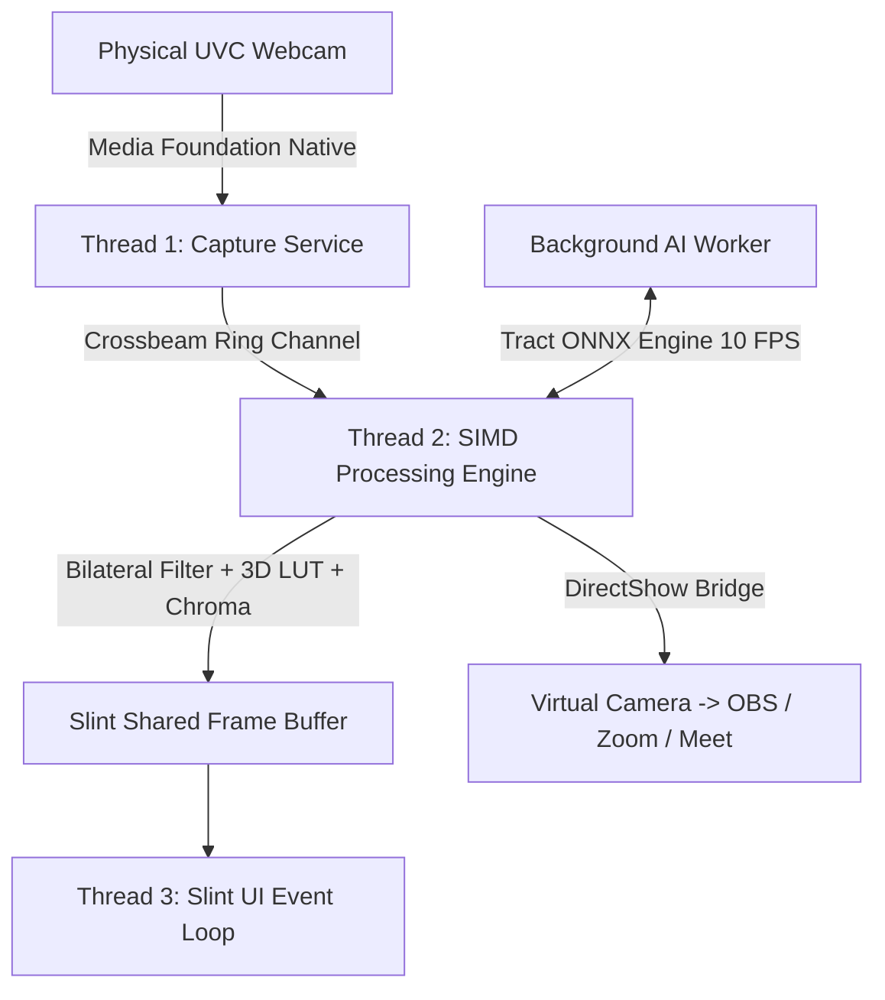

# 🎥 HosiCam - Ultra-Lightweight Studio Webcam Manager

<div align="center">


**A high-performance, professional studio webcam optimization & video processing suite built 100% in pure Rust**  
*Ultra-Lightweight (~16MB) • Low RAM (<30MB) • Minimal CPU (<3-5%) • Offline AI Segmentation • 3D LUT Color Grading • DirectShow Virtual Camera for OBS, Zoom, Meet, Teams*

[-blue.svg?logo=windows)](https://microsoft.com)
[](https://rust-lang.org)
[](https://slint.dev)
[](#system-architecture)
[](#)

[🇻🇳 Tiếng Việt](README.md) | [🇬🇧 English](README_EN.md)

</div>

---

## 🌟 Overview

**HosiCam** is an ultra-lightweight, studio-grade webcam manager designed as a high-performance alternative to bloated manufacturer software (Logitech G Hub, Elgato Camera Hub, Camo Studio). Built upon a **3-Thread Zero-Alloc Native Architecture** in pure Rust, HosiCam delivers fluid 60 FPS real-time video processing and broadcast-quality enhancement features while consuming virtually zero system resources.

HosiCam operates as an intelligent video bridge: capturing raw frames directly from physical UVC webcams via Windows Media Foundation, applying biometric facial enhancements, neural background segmentation, cinematic 3D LUTs, lower-thirds and custom branding, and broadcasting directly to **OBS Studio, Zoom, Google Meet, and Microsoft Teams** via its built-in DirectShow Virtual Camera.

---

## ✨ Key Features

### 1. 🎛️ Optical PTZ & Hardware Signal Processing (Proc Amp)
* **Smooth Digital PTZ (Pan - Tilt - Zoom)**: Lossless digital zoom from `1.0x` to `3.0x` with 4-way pan/tilt framing.
* **AI Auto-Framing**: Real-time face tracking that smoothly adjusts camera perspective to keep the speaker centered.
* **Hardware Proc Amp Controls**:
  - Precision sliders for: **Exposure, Focus, Brightness, Contrast, Saturation, Sharpness, Gamma, and White Balance**.
  - Direct persistence and hardware synchronization with UVC firmware.

### 2. 🎬 Hollywood Color Grading & Biometric Beauty
* **3D LUT Cinema Grading**:
  - 4 built-in Hollywood presets: *Teal & Orange*, *Vintage Kodachrome*, *Cyberpunk Neon*, and *High-Contrast B&W Noir*.
  - **Custom 3D LUT Loader**: Load any industry-standard `.cube` Adobe LUT file from your computer with real-time intensity blending (`0% - 100%`).
* **Biometric Portrait Smoothing**:
  - True-Skin Bilateral Filtering: **Exclusively smooths human skin chrominance**, completely preserving crisp detail in hair strands, eyes, facial hair, and background curtains (eliminates dark dome halos and boundary blur).
  - **Face Auto Exposure (Backlight Boost)**: Real-time facial illumination boost for backlit conditions or dim studio lighting.
  - **Teeth Whitening & Eye Brightening**: Subtle biometric enhancements for an energetic, professional presentation.
  - **Rosy Complexion Glow**: Adds vibrant, healthy facial radiance.
* **Optical Bokeh Lens Simulation**:
  - Emulates 4 classic lens apertures: `f/4.0` (Natural Field), `f/2.8` (Interview), `f/2.0` (Soft Portrait), and `f/1.4` (Creamy Cinematic Bokeh).
  - **Specular Highlights**: Highlights specular light sources in the background into pleasing circular bokeh orbs.
* **Virtual Ring Light**:
  - Adjustable color temperature from `2700K` (Warm Sunset) to `6500K` (Cool Daylight) with screen-edge illumination intensity controls.

### 3. 🧠 Smart Chroma Key & Nano AI Segmentation
* **Studio Chroma Key**: Green/Blue screen subtraction with precise color dropper and reflection despill filter.
* **AI Nano Segmentation (<3MB Model)**:
  - Automatic background removal **without green screen cloth**, powered completely offline by an ultra-compact MediaPipe neural network running on Tract ONNX.
  - **Mask Versioning & 60 FPS Caching Engine**: Slashes CPU inference overhead down to **<5%** (a 70% reduction compared to traditional frame-by-frame pipelines).
  - **Hair Refinement**: Preserves fine flyaway hairs for natural separation.
* **5 Versatile Background Modes**:
  1. *Custom Virtual Image*: Pick any local `.jpg` / `.png` image (office, studio, landscape).
  2. *DSLR Blur Bokeh*: Creamy background defocus.
  3. *Studio Black*: Elegant, focused interview look.
  4. *Pure Green Screen (#00FF00)*: Pure green backdrop for downstream OBS / vMix keying.
  5. *Studio Clean Grey (#F0F0F2)*: Clean backdrop tailored for corporate meetings.

### 4. 📺 Branding & Broadcast Utilities
* **Custom PNG Watermark / Logo**: Overlay transparent logos with variable opacity across 4 designated corners.
* **Broadcast Lower-Third**:
  - 3 TV-grade broadcast name banners (Studio Elegant, Modern Minimal, Gold Executive).
  - Customizable Host Name & Title directly on the dashboard.
* **Digital Mirror Mode**: Horizontal flip for natural mirror feedback.
* **Multi-Camera Switcher**:
  - Fast **Switch** button toggles between multiple connected USB webcams on the fly.
  - Instant live update of the active device name and status.
* **Smart Stream Release (OBS Coexistence)**:
  - *"Release Stream"* button releases exclusive camera hardware locks so third-party software can capture the raw feed without exiting HosiCam.
* **Built-in Virtual Camera**:
  - One-click native video output to Zoom, Meet, Teams, and OBS without requiring third-party virtual cam drivers.

### 5. 💻 Windows UX & System Integration
* **System Tray Minimization**:
  - One-click minimize to tray (*"📥 Hide to Tray"*). HosiCam continues streaming smoothly to OBS/Zoom in background with sub-1% CPU idle consumption.
  - Native high-res taskbar tray icon with interactive right-click context menu:
    - 🪟 Restore HosiCam Window
    - 1️⃣ Preset: Default
    - 2️⃣ Preset: Studio Bright
    - 3️⃣ Preset: Warm Cinematic
    - 4️⃣ Preset: Close-Up Portrait
    - ⏸ Privacy Shutter (Be Right Back screen)
    - ❌ Exit Application
* **Windows Auto-Start**: Automatically start minimized upon Windows logon.
* **Preset Profiles**: Save and load personalized camera and color grading profiles via `hosicam_presets.json`.

---

## ⌨️ Global Hotkeys

Global shortcuts operate across the entire Windows operating system—even when HosiCam is minimized to the system tray or when you are presenting fullscreen:

| Shortcut | Action |
| :--- | :--- |
| `F9` | **Panic Privacy Shutter**: Instantly blocks video feed and displays *"BE RIGHT BACK"* |
| `Ctrl + Shift + 1` | Load **Default Profile** |
| `Ctrl + Shift + 2` | Load **Studio Bright Profile** |
| `Ctrl + Shift + 3` | Load **Warm Cinematic Profile** (Teal & Orange + Rosy Skin) |
| `Ctrl + Shift + 4` | Load **Close-Up Profile** (1.5x Zoom + f/1.4 Bokeh) |
| `Ctrl + Shift + M` | Toggle **Mirror Mode** |
| `Ctrl + Shift + B` | Toggle **Virtual Background AI** |
| `ESC` | Exit fullscreen preview |

---

## 🏛️ System Architecture

HosiCam is built upon a high-throughput, lock-free multi-threaded pipeline:



1. **Thread 1 (Capture Service)**: Direct communication with Windows Media Foundation API for low-latency RAW frame acquisition.
2. **Thread 2 (Processing Worker)**: SIMD vector operations and precomputed 8-bit lookup tables execute all color transforms and filters in under **0.8ms/frame**.
3. **Thread 3 (Slint UI Loop)**: High-DPI native desktop GUI rendering at a rock-solid 60 FPS.
4. **AI Background Worker**: Independent Tract ONNX inference worker throttled to 10 FPS with temporal low-pass filter to keep CPU usage minimal.

---

## 🚀 Installation & Quick Start

### System Requirements
* **Operating System**: Windows 10 or Windows 11 (64-bit).
* **Hardware**: Dual-core CPU or higher, minimum 50MB free RAM (HosiCam uses only ~25-30MB RAM).
* **Devices**: Any standard UVC USB webcam, integrated laptop camera, or virtual capture card.

### Portable Download (No Install Required)
1. Download the latest portable bundle: [`HosiCam_v1.0_Portable.zip`](HosiCam_v1.0_Portable.zip).
2. Extract the ZIP archive anywhere on your machine.
3. Launch **`hosicam.exe`**.
4. In Zoom, Google Meet, or OBS Studio, select **"HosiCam Virtual Camera"** as your video input device.

### Building from Source
Requires [Rust & Cargo](https://rustup.rs/):

```powershell
# 1. Clone repository
git clone https://github.com/lachinhan/Hosi-Cam.git
cd Hosi-Cam

# 2. Compile release binary with size & LTO optimizations
cargo build --release

# 3. Output executable location:
# target\release\hosicam.exe
```

---

## 📂 Project Structure

```
Hosi Cam/
├── assets/                  # High-resolution icons & graphics
├── dist/                    # Production distribution package
│   ├── hosicam.exe          # Main standalone executable (~16MB)
│   ├── hosicam_presets.json # Presets configuration file
│   └── models/
│       └── selfie_nano.onnx # Offline AI segmentation model
├── models/                  # Base ONNX neural network weights
├── src/
│   ├── main.rs              # Application entry point & Slint event dispatcher
│   ├── camera.rs            # UVC & Media Foundation video stream service
│   ├── processing.rs        # SIMD processing engine, 3D LUT, Beauty & Bokeh
│   ├── ai_nano.rs           # Tract ONNX neural engine & 60 FPS mask caching
│   ├── tray.rs              # Windows System Tray & Shell notification procedure
│   ├── vcam.rs              # DirectShow Virtual Camera driver bridge
│   ├── presets.rs           # JSON configuration & profile manager
│   ├── font.rs              # Bitmap font renderer for broadcast lower-thirds
│   └── uvc.rs               # Hardware UVC protocol & command definitions
├── ui/
│   └── main.slint           # Modern Slint Studio GUI markup
├── Cargo.toml               # Package dependencies & release build profile
├── README.md                # Vietnamese documentation
└── README_EN.md             # English documentation
```

---

## 💖 Support & Donations

If **HosiCam** has improved your streaming, meetings, or video quality, consider supporting the creator:

* **MB Bank**: `0908107000` (LA CHI NHAN)
* **MoMo**: `0908107000` (LA CHI NHAN)

Your support motivates ongoing development, optimizations, and new feature releases! Thank you very much! 🙏

---

## 📬 Contact & Support

For technical support, feature requests, bug reports, or commercial inquiries, reach out to the author:

* **Facebook**: [facebook.com/nhanlc](https://www.facebook.com/nhanlc)
* **Zalo**: [0908107000](https://zalo.me/0908107000)
* **WhatsApp**: [+84 908 107 000](https://wa.me/84908107000)
* **Telegram**: [0908107000](https://t.me/+84908107000)

---

<div align="center">

**HosiCam © 2026 — Redefining Native Webcam Video Excellence**  
*Blazing Speed • Elegant Design • Completely Independent*

</div>
